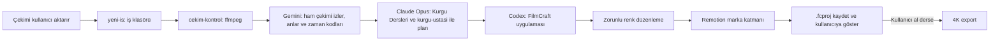

# Kurgu sistemi

## English summary

This repository provides an AI assisted video editing workflow built around FilmCraft and Remotion. It is intended for people working with Claude Code, Codex, and Gemini. It includes editing skills, helper scripts, templates, and Remotion examples. Adapt the local paths and models to your setup.

Claude Code, Codex ve Gemini ile çalışanlar için FilmCraft ve Remotion tabanlı yapay zekâ destekli kurgu hattı. Çekimden projeye kadar yardımcı betikler, beceriler ve örnekler içerir. Çekimleri kullanıcı aktarır.

## Kurallar

FilmCraft 0.10.0'da canlı MCP köprüsü `127.0.0.1:9876` veya `filmcraft-headless` kullanılır. Kesme, ses, altyazı ve grafik FilmCraft'ta yapılır. Renk düzenlemesi her işte zorunludur: S-Log3 ise Sony LUT, scopes ile pozlama ve beyaz denge ölçümü, ten rengi, `applyMatch`, hafif look ve önce/sonra kontrolü. Remotion'da `src/Reels07.tsx` ev stili, `src/marka.ts` ve `public/sfx/katalog.json` marka katmanını oluşturur. Kurgu bitince `.fcproj` kaydedilir; kullanıcı “al” demeden export yapılmaz. Çıktı daima 4K: dikey 2160×3840, yatay 3840×2160; HD yok. Ayrıntı: [kurallar](docs/kurallar.md).

## Kurulum

Kurulum betikleri zsh kullanır. `zsh kurulum.sh --kuru` değişiklikleri gösterir; `zsh kurulum.sh` sembolik bağları kurar. Mevcut gerçek dosya ve klasörler tarihli `.yedek-*` adına taşınır. `cd remotion && npm ci` ile Remotion bağımlılıklarını kurun. [NODE_SURUMU.md](remotion/NODE_SURUMU.md) temiz kurulumda Node 22.23.3 ve 24.22.0 sürümlerini doğrular; mevcut Node 24 kullanılabilir.

Bağımlılıklar: ffmpeg, Node.js, Python 3, FilmCraft 0.10.0 uygulaması ve `filmcraft-cli`, Antigravity CLI `agy`, Codex CLI, Ollama, edge-tts, whisper-cli (`ggml-small` modeli), auto-editor. Claude CLI ve Gemini erişimi de akışta kullanılır. Dış kitler ayrıca kurulur, depoya dahil değildir: herk-edit-kit (`cut-silences`, `cut-mistakes`, `edit-video`, `short-form-edit` vb.), `~/.claude/remotion-skills`, hyperframes.

FilmCraft MCP örneği: [mcp/filmcraft.mcp.json](mcp/filmcraft.mcp.json). JSON içindeki `$HOME` kabukta genişletilmez; kendi ev dizininizin mutlak yoluyla değiştirin. Kurulum betiği `claude mcp add` komutlarını yalnızca ekrana yazar.

## Araçlar

| Araç | Kullanım |
| --- | --- |
| `yeni-is` | `yeni-is "Müşteri" "İş" [--format 9x16\|16x9\|ikisi]` → `~/Movies/Isler/<tarih>_<musteri>_<is>/`; yerel wiki kaydı da oluşturur. |
| `cekim-kontrol` | `cekim-kontrol <klasör>` ile ffmpeg teknik kontrolü. |
| `gemini-run` | `gemini-run video "En iyi anları zaman kodlarıyla bul" -d <klasör>`. |
| `codex-run` | Codex'e uygulama görevi devri. |
| `codex-img` | Codex görsel işi. |
| `codex-img-batch` | Toplu görsel işi. |
| `yerel-run` | Ollama ile yerel döküm temizleme gibi işler. |

## Klasörler

- `bin/`: yedi yerel yardımcı betik.
- `skills/`: kurgu ve FilmCraft becerileri.
- `remotion/`: Nexus Video kaynakları ve marka varlıkları. [FilmCraft komutları](remotion/araclar/filmcraft-komutlar.txt).
- `docs/`: dersler, rehberler, analizler ve kullanıcı kuralları.
- `hooks/`: video hattı kancası.
- `mcp/`: örnek MCP yapılandırması.
- `sablonlar/is-klasoru/`: `yeni-is` iş klasörü örneği.

## Uyarlanabilir ayarlar

Varsayılan kurulum macOS üzerindeki zsh ortamına göre yazılmıştır. İş klasörü `~/Movies/Isler`, yerel kaynak yolları, Codex model seçimi ve Ollama modelleri kendi ortamınıza göre düzenlenebilir. Bu ayarlar için `bin/` ve kurulum betiklerine bakın.

## Senkronizasyon

Canlı kaynaklardan tek yönlü güncelleme: `zsh senkronla.sh`. `docs/` ve `skills/kurgu-ustasi/` kopyalanmaz; özellikle `docs/Kurgu Dersleri.md` dosyasının elle temizlenmiş genel sürümü korunur. Müşteriye özel Remotion dosyaları da hariç tutulur. Senkronizasyondan sonra gizli bilgi ve büyük dosya denetimini yeniden yapın.

## Lisans

Kod ve belgeler [MIT lisansı](LICENSE) altındadır. Nexus Studio CS logosu ve marka varlıkları bu lisansın dışındadır; tüm hakları saklıdır. Üçüncü taraf bileşenler için [THIRD_PARTY.md](THIRD_PARTY.md) dosyasına bakın.
