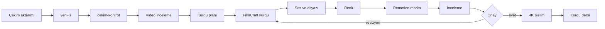

# Kurgu Sistemi

Yapay zekâ destekli, kaynak korumalı ve ölçülebilir bir video kurgu iş akışı. Sistem çekim denetimi, planlama, FilmCraft zaman çizelgesi, Remotion marka katmanı, yerel metin araçları ve kalıcı kurgu derslerini tek depoda birleştirir.

Kurgu Sistemi is a public, source-oriented video editing workflow for macOS. It combines footage inspection, AI-assisted planning, FilmCraft timeline automation, Remotion graphics, local transcription, and repeatable quality gates. Raw media remains outside the repository and is never treated as disposable. AI tools support decisions but do not replace human review or final approval. The documentation favors verified commands, explicit paths using `$HOME`, and reproducible checks. Final 4K export happens only after review approval.

## Özellikler

- Salt okunur teknik çekim kontrolü
- Video için zaman kodlu yapay zekâ incelemesi
- Tür bazlı Codex, Gemini/agy ve Ollama yönlendiricileri
- FilmCraft canlı ve başsız MCP bağlantısı
- Craft ailesi (FilmCraft, EffectCraft, SoundCraft, PhotoCraft, VectorCraft, PdfCraft) için başlatıcılar (`craft-ac`, `filmcraft-ac`, `filmcraft-kopru`) ve uçtan uca tarifler (`sablonlar/craft-tarifler/`)
- `sinema-kalitesi` skill'i: araç seçim matrisi, birleştirme hattı ve ölçümlü kalite kapıları
- Zaman çizelgesi, ses, altyazı ve zorunlu renk akışı
- Remotion tabanlı tekrar kullanılabilir marka katmanı
- Whisper kelime/segment zamanları
- Uzun videodan Reels/Shorts çıkarma
- Katalog doğrulamalı ses efektleri
- Kurulum, doğrulama ve müşteri içeriğini dışarıda tutan güvenli senkron betikleri
- Alt modül tabanlı dış beceri/araç koleksiyonu

## Akış



Kurulum seçenekleri arasında `--guncelle-kancasi` ve `--guncelle-kancasi-kaldir` bulunur; `--hepsi` eklemeyi seçer.

## Gereksinimler

Yalnız macOS (Apple Silicon’da test edildi).

## Hızlı başlangıç

Claude Code ile kurulum: deponun linkini Claude’a verip “[KURULUM-CLAUDE.md](KURULUM-CLAUDE.md)’ye göre kur” deyin.

```sh
git clone --recursive https://github.com/Ustakalfa/kurgu-sistemi.git ~/kurgu-sistemi
cd ~/kurgu-sistemi
./kurulum.sh --kuru
./kurulum.sh --hepsi --evet
./dogrula.sh
```

`--hepsi`, `--guncelle-kancasi` seçeneğini de içerir; yalnız oturum açılışı güncellemesini kurmak için `./kurulum.sh --guncelle-kancasi` kullanın.

Depo adresi: <https://github.com/Ustakalfa/kurgu-sistemi>. FilmCraft canlı köprüsü (kontrol anahtarıyla, önerilen yol):

```sh
filmcraft-ac
```

FilmCraft 0.13 ve sonrası canlı modda kontrol anahtarı ister; anahtarsız `--control 9876` bağlantısı reddedilir.

Yeni iş ve çekim denetimi:

```sh
yeni-is "Ornek" "Tanitim" --format 9x16
cekim-kontrol "$HOME/Movies/Isler/<YYYY-AA-GG>_ornek_tanitim/01-ham" --hizli
```

## Nasıl çalışır: Claude kaptan, Codex işçi, Gemini göz

1. Claude briefi okur, planı kurar, karar verir ve kalite kapılarını denetler.
2. Gemini (`gemini-run video`) ham videoyu izler; klip ve zaman kodlu bulguları Claude'a verir.
3. Codex Remotion kodu, betik, toplu iş, belge ve görsel üretir; gerektiğinde verilen penceresiz FilmCraft adım dosyasını yürütür.
4. Yerel model (`yerel-run`) dökümü temizler ve yardımcı etiketler üretir; sonucu Claude denetler.
5. Claude FilmCraft MCP ile kurgu ve renk düzenlemesini bizzat yürütür; kritik kareleri MCP aracı `render_frame` ile kontrol eder.
6. Sekans baştan 4K kurulur; her videoda renk yapılır ve `.fcproj` dosyası `04-kurgu/` altında kaydedilir.
7. Kullanıcı açıkça “al” demeden export yapılmaz; onaylı 4K çıktı `06-teslim/` içine alınır.

Bu düzenin tam metni [Claude kural bloğunda](claude/CLAUDE.kurgu.md), devir ayrıntıları [kurgu-ekip skill'inde](skills/kurgu-ekip/SKILL.md) bulunur. `./kurulum.sh --guncelle-kancasi` Claude Code oturum açılışına sessiz güncelleme ekler. `./kurulum.sh --claude-md` bloğu `~/.claude/CLAUDE.md` içine ekler veya günceller; `--claude-md-kaldir` yalnız işaretli bloğu kaldırır; `--hooks` kurulu hookify eklentisi varsa yerel video hattı kuralını bağlar. [Denetim raporu](docs/denetim-raporu.md) düzeltmelerin kaydını tutar.

## Craft ailesi

Kurgu Craft uygulamalarıyla yapılır; Remotion yalnız Craft'ın karşılamadığı yerlerde, özellikle tipografi ve hareketli yazıda kullanılır. 4K alfa kıyasında yazı grafiğinde Remotion, görüntü efekti, ışık, gren ve 3D'de EffectCraft öne çıktı.

| Uygulama | Görev |
|---|---|
| FilmCraft | kurgu, renk, altyazı, teslim (canlı ve başsız MCP) |
| EffectCraft | hareketli grafik, ışık, gren, 3D; ProRes 4444 alfa |
| SoundCraft | ses temizliği, miks, MIDI beste |
| PhotoCraft | kapak ve küçük resim |
| VectorCraft | logo, ikon, vektör |
| PdfCraft | belge |

`craft-ac <uygulama>` canlı köprüyü anahtarla açar. Komutları uydurmayın; önce `<uygulama>-cli commands` çıktısından doğrulayın. Ayrıntı: [Craft ailesi](docs/craft-ailesi.md), sürümler: [Sürümler](docs/surumler.md).

## Kalite kapıları

- Sekans baştan 4K: yatay 3840×2160, dikey 2160×3840.
- Her videoda ölçümle renk düzeltme, ardından hafif look; önce/sonra karesi.
- Teslimden önce tam tarama: baştan sona yaklaşık 2 sn'de bir kare, her grafik ve geçişin hemen sonrası, ses LUFS/TP, altyazı görünürlüğü, son kare. Her düzeltmeden sonra tarama yinelenir.
- Uzun kayıttan kısa video: önce anlam haritası ve video listesi, kullanıcı onayı; az ve seçkin.
- Kurgu planı ve büyük yaratıcı kararlar üretimden önce onaylanır.
- Export yalnız açık onayla (“al”).

## Yapay zekâ araç kararları

- Yerel yapay zekâ ile **video üretimi yapılmaz**; odak eldeki kurgu ve efekt araçlarını iyi kullanmaktır.
- **Müzik üretimi var:** Magenta RT small (sözsüz, CC BY 4.0, atıf gerekir) ve ACE-Step 1.5 (MIT; Türkçe vokal zayıf, sözsüz kullanılır).
- Yardımcılar: DeepFilterNet (konuşma temizliği), PySceneDetect, SAM 2.1, Real-ESRGAN, RIFE, colour-science, librosa. Bunlar depoda değildir; kullanıcı ayrıca kurar.
- Lisans nedeniyle müşteri işinde kullanılmayanlar: MusicGen/AudioGen, AudioLDM2, YuE, Demucs ağırlıkları, CoTracker3, MatAnyone, BRIA rembg modelleri, Stable Audio Open.

## Model ayarı

`kurulum.sh`, [örnek model ayarını](config/modeller.ornek.env) `~/.config/kurgu-sistemi/modeller.env` konumuna kopyalar. Dosyadaki Codex, Gemini ve yerel model zincirlerini kendi aboneliğinize göre düzenleyin. Çağrıdaki ortam değişkenleri dosyadaki değerlerden önceliklidir.

## Klasör haritası

| Yol | Amaç |
|---|---|
| `bin/` | kullanıcı komutları ve model yönlendiricileri |
| `docs/` | mimari, kurulum ve üretim rehberleri |
| `skills/` | yerel kurgu becerileri ve [HARİTA](skills/HARITA.md) |
| `remotion/src/` | kompozisyonlar, marka ve SFX API'si |
| `remotion/araclar/` | Reels, FilmCraft, paralaks ve SFX araçları |
| `remotion/public/` | render varlıkları ve SFX kataloğu |
| `vendor/avenoxskills/` | video ve üretim becerileri alt modülü |
| `vendor/herk-edit-kit/` | kurgu araç/örnek alt modülü |
| `vendor/hyperframes/` | programatik video çerçevesi alt modülü |
| `vendor/remotion-skills/` | Remotion becerileri alt modülü |
| `vendor/done-is-a-claim/` | doğrulama yaklaşımı alt modülü |
| `vendor/sessizkes/` | sessizlik tabanlı kesme alt modülü |
| `kurulum.sh` | seçilebilir kurulum ve sembolik bağlar |
| `dogrula.sh` | sözdizimi, tip, self-test ve içerik denetimi |
| `senkronla.sh` | izin verilen yerel kaynakları depoya eşleme |

`vendor/` dış kaynaktır ve salt okunur kabul edilir. Alt modül içeriğini bu deponun yerel kodu gibi değiştirmeyin.

## Belge dizini

| Belge | İçerik |
|---|---|
| [Mimari](docs/mimari.md) | uçtan uca aşamalar ve kalite kapıları |
| [Kurulum](docs/kurulum.md) | sıfır Mac, seçenekler, güncelleme |
| [Araçlar](docs/araclar.md) | bütün yerel komutlar |
| [FilmCraft](docs/filmcraft.md) | MCP, zaman çizelgesi, renk ve teslim |
| [Remotion](docs/remotion.md) | kompozisyonlar, SFX, render |
| [Ses efektleri](docs/ses-efektleri.md) | katalog ve yeniden üretim |
| [Ekip düzeni](docs/ekip-duzeni.md) | kaptan/işçi ve model zincirleri |
| [Sorun giderme](docs/sorun-giderme.md) | belirti–neden–çözüm |
| [Örnek iş](docs/ornek-is.md) | baştan sona kurgusal uygulama |
| [Ekipman](docs/ekipman.md) | kamera, ses, depolama, proxy/4K |
| [Kurallar](docs/kurallar.md) | değişmez çalışma kuralları |
| [Kurgu Ustalığı Rehberi](docs/Kurgu%20Ustalığı%20Rehberi.md) | yaratıcı ve teknik başvuru |
| [Kurgu Dersleri](docs/Kurgu%20Dersleri.md) | genellenebilir öğrenimler |
| [Craft ailesi](docs/craft-ailesi.md) | Craft uygulamaları, komutlar, tarifler |
| [Sürümler](docs/surumler.md) | doğrulanmış araç ve paket sürümleri |
| [Değişiklikler](docs/degisiklikler.md) | tarihli değişiklik günlüğü |
| [Yerel değişiklikler](docs/yerel-degisiklikler.md) | senkron davranışı ve korunan dosyalar |

## Kuralların özeti

1. Ham medyayı değiştirmeyin; en az iki doğrulanmış kopya tutun.
2. Teknik ölçüm, görsel inceleme ve yaratıcı kararı birbirinin yerine koymayın.
3. Yapay zekâ bulgusunu klip ve zaman koduyla doğrulayın.
4. Ses ve altyazıyı gerçek oynatmada kontrol edin.
5. Renk aşamasını atlamayın; LUT'u tek başına düzenleme saymayın.
6. Kişisel, gizli, lisanssız veya işe özel veriyi kamu deposuna koymayın.
7. Kullanıcı onayı olmadan nihai 4K dışa aktarma yapmayın.
8. Türetilmiş çıktı ile ham kaynağı aynı klasöre yazmayın.
9. Komut/parametreyi gerçek betik veya yardım çıktısından doğrulayın.
10. İş sonunda genellenebilir dersi kişisel veriden arındırarak kaydedin.

## Katkı ve senkron

Katkıdan önce `./dogrula.sh` çalıştırın. `./senkronla.sh` (önce `--kuru` ile deneyin) yalnız depoda zaten izlenen Remotion dosyalarını günceller; canlıdaki yeni dosyaları kopyalamaz, “elle karar ver” diye listeler. `config/senkron-korunan.txt` içindeki dosyalar hiç ezilmez ve her dosya gizlilik deseniyle taranır (kişiye özel desenler depo dışında: `$HOME/.config/kurgu-sistemi/gizli-desenler.txt`, örnek `config/gizli-desenler.ornek.txt`). Betik medya, WAV, proje, ortam dosyası, `node_modules` ve büyük dosyaları dışlar. `bin/` ve `skills/` deponun asıl kaynağıdır: betik bunları kopyalamaz, yalnız `~/.local/bin/`, `~/.claude/skills/` ve proje `.claude/skills/` bağlantılarını denetler; farklı içerik için elle birleştirme ya da `./kurulum.sh --bin --skills` ile depoya bağlama uyarısı verir. Aynı anda çalışan kişilerin dosya sahipliğini önceden ayırın. Alt modül güncellemesi ayrı ve gözden geçirilebilir bir değişiklik olmalıdır.

## Güvenlik ve mahremiyet

İş medyası depoya konmaz. Örneklerde `$HOME` veya `~` kullanılır; kişisel mutlak yol yazılmaz. Günlükler model/tür/süre/sonuç gibi işletim verisini tutar. Bir yazma işleminin tamamlanıp tamamlanmadığı belirsizse başka yüzeyden otomatik tekrar edilmez.

## Lisans

Depo kodu [MIT](LICENSE) lisanslıdır. Nexus marka varlıkları (logo, marka renkleri) MIT kapsamı dışındadır, tüm hakları saklıdır. `vendor/` altındaki alt modüller kendi lisanslarını taşır: [THIRD_PARTY.md](THIRD_PARTY.md).

