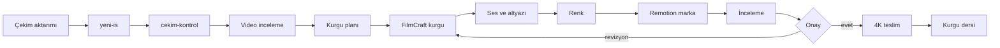

# Kurgu Sistemi

Yapay zekâ destekli, kaynak korumalı ve ölçülebilir bir video kurgu iş akışı. Sistem çekim denetimi, planlama, FilmCraft zaman çizelgesi, Remotion marka katmanı, yerel metin araçları ve kalıcı kurgu derslerini tek depoda birleştirir.

Kurgu Sistemi is a public, source-oriented video editing workflow for macOS. It combines footage inspection, AI-assisted planning, FilmCraft timeline automation, Remotion graphics, local transcription, and repeatable quality gates. Raw media remains outside the repository and is never treated as disposable. AI tools support decisions but do not replace human review or final approval. The documentation favors verified commands, explicit paths using `$HOME`, and reproducible checks. Final 4K export happens only after review approval.

## Özellikler

- Salt okunur teknik çekim kontrolü
- Video için zaman kodlu yapay zekâ incelemesi
- Tür bazlı Codex, Gemini/agy ve Ollama yönlendiricileri
- FilmCraft canlı ve başsız MCP bağlantısı
- Zaman çizelgesi, ses, altyazı ve zorunlu renk akışı
- Remotion tabanlı tekrar kullanılabilir marka katmanı
- Whisper kelime/segment zamanları
- Uzun videodan Reels/Shorts çıkarma
- Katalog doğrulamalı ses efektleri
- Kurulum, doğrulama ve senkron betikleri
- Alt modül tabanlı dış beceri/araç koleksiyonu

## Akış



## Gereksinimler

Yalnız macOS (Apple Silicon’da test edildi).

## Hızlı başlangıç

Claude Code ile kurulum: deponun linkini Claude’a verip “[KURULUM-CLAUDE.md](KURULUM-CLAUDE.md)’ye göre kur” deyin.

```sh
git clone --recursive https://github.com/Ustakalfa/kurgu-sistemi.git ~/kurgu-sistemi
cd ~/kurgu-sistemi
./kurulum.sh --kuru
./kurulum.sh --hepsi --evet
./dogrula.sh
```

`https://github.com/Ustakalfa/kurgu-sistemi.git` yer tutucudur; gerçek genel URL bu çalışma ağacında doğrulanmadı. FilmCraft canlı köprüsü:

```sh
open -a FilmCraft --args --control 9876
```

Yeni iş ve çekim denetimi:

```sh
yeni-is "Ornek" "Tanitim" --format 9x16
cekim-kontrol "$HOME/Movies/Isler/2026-11-03_ornek-kafe_tanitim-reels/01-ham" --hizli
```

## Model ayarı

`kurulum.sh`, [örnek model ayarını](config/modeller.ornek.env) `~/.config/kurgu-sistemi/modeller.env` konumuna kopyalar. Dosyadaki Codex, Gemini ve yerel model zincirlerini kendi aboneliğinize göre düzenleyin. Çağrıdaki ortam değişkenleri dosyadaki değerlerden önceliklidir.

## Klasör haritası

| Yol | Amaç |
|---|---|
| `bin/` | kullanıcı komutları ve model yönlendiricileri |
| `docs/` | mimari, kurulum ve üretim rehberleri |
| `skills/` | yerel kurgu becerileri ve [HARİTA](skills/HARITA.md) |
| `remotion/src/` | kompozisyonlar, marka ve SFX API'si |
| `remotion/araclar/` | Reels, FilmCraft, paralaks ve SFX araçları |
| `remotion/public/` | render varlıkları ve SFX kataloğu |
| `vendor/avenoxskills/` | video ve üretim becerileri alt modülü |
| `vendor/herk-edit-kit/` | kurgu araç/örnek alt modülü |
| `vendor/hyperframes/` | programatik video çerçevesi alt modülü |
| `vendor/remotion-skills/` | Remotion becerileri alt modülü |
| `vendor/done-is-a-claim/` | doğrulama yaklaşımı alt modülü |
| `vendor/sessizkes/` | sessizlik tabanlı kesme alt modülü |
| `kurulum.sh` | seçilebilir kurulum ve sembolik bağlar |
| `dogrula.sh` | sözdizimi, tip, self-test ve içerik denetimi |
| `senkronla.sh` | izin verilen yerel kaynakları depoya eşleme |

`vendor/` dış kaynaktır ve salt okunur kabul edilir. Alt modül içeriğini bu deponun yerel kodu gibi değiştirmeyin.

## Belge dizini

| Belge | İçerik |
|---|---|
| [Mimari](docs/mimari.md) | uçtan uca aşamalar ve kalite kapıları |
| [Kurulum](docs/kurulum.md) | sıfır Mac, seçenekler, güncelleme |
| [Araçlar](docs/araclar.md) | bütün yerel komutlar |
| [FilmCraft](docs/filmcraft.md) | MCP, zaman çizelgesi, renk ve teslim |
| [Remotion](docs/remotion.md) | kompozisyonlar, SFX, render |
| [Ses efektleri](docs/ses-efektleri.md) | katalog ve yeniden üretim |
| [Ekip düzeni](docs/ekip-duzeni.md) | kaptan/işçi ve model zincirleri |
| [Sorun giderme](docs/sorun-giderme.md) | belirti–neden–çözüm |
| [Örnek iş](docs/ornek-is.md) | baştan sona kurgusal uygulama |
| [Ekipman](docs/ekipman.md) | kamera, ses, depolama, proxy/4K |
| [Kurallar](docs/kurallar.md) | değişmez çalışma kuralları |
| [Kurgu Ustalığı Rehberi](docs/Kurgu%20Ustalığı%20Rehberi.md) | yaratıcı ve teknik başvuru |
| [Kurgu Dersleri](docs/Kurgu%20Dersleri.md) | genellenebilir öğrenimler |

## Kuralların özeti

1. Ham medyayı değiştirmeyin; en az iki doğrulanmış kopya tutun.
2. Teknik ölçüm, görsel inceleme ve yaratıcı kararı birbirinin yerine koymayın.
3. Yapay zekâ bulgusunu klip ve zaman koduyla doğrulayın.
4. Ses ve altyazıyı gerçek oynatmada kontrol edin.
5. Renk aşamasını atlamayın; LUT'u tek başına düzenleme saymayın.
6. Kişisel, gizli, lisanssız veya işe özel veriyi kamu deposuna koymayın.
7. Kullanıcı onayı olmadan nihai 4K dışa aktarma yapmayın.
8. Türetilmiş çıktı ile ham kaynağı aynı klasöre yazmayın.
9. Komut/parametreyi gerçek betik veya yardım çıktısından doğrulayın.
10. İş sonunda genellenebilir dersi kişisel veriden arındırarak kaydedin.

## Katkı ve senkron

Katkıdan önce `./dogrula.sh` çalıştırın. `./senkronla.sh`, Remotion kaynaklarını bilinçli olarak depoya eşler; medya, WAV, proje, ortam dosyası, `node_modules` ve büyük dosyaları dışlar. `bin/` ve `skills/` deponun asıl kaynağıdır: betik bunları kopyalamaz, yalnız `~/.local/bin/`, `~/.claude/skills/` ve proje `.claude/skills/` bağlantılarını denetler; farklı içerik için elle birleştirme ya da `./kurulum.sh --bin --skills` ile depoya bağlama uyarısı verir. Aynı anda çalışan kişilerin dosya sahipliğini önceden ayırın. Alt modül güncellemesi ayrı ve gözden geçirilebilir bir değişiklik olmalıdır.

## Güvenlik ve mahremiyet

İş medyası depoya konmaz. Örneklerde `$HOME` veya `~` kullanılır; kişisel mutlak yol yazılmaz. Günlükler model/tür/süre/sonuç gibi işletim verisini tutar. Bir yazma işleminin tamamlanıp tamamlanmadığı belirsizse başka yüzeyden otomatik tekrar edilmez.

## Lisans

Depo lisans dosyası bu çalışma ağacında doğrulanmadı. Kamuya açmadan önce kökte açık bir lisans dosyası eklenmeli ve üçüncü taraf alt modüller ile medya varlıklarının kendi lisansları ayrıca korunmalıdır. Lisans belirlenene kadar kullanım hakları “doğrulanmadı” kabul edilmelidir.

