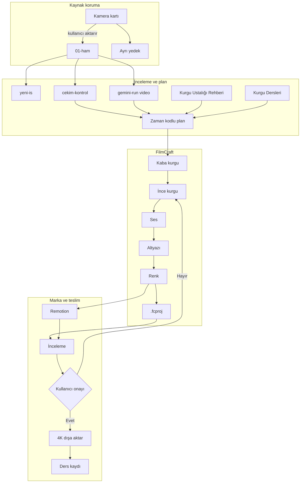

# Kurgu Sistemi Mimarisi

Bu belge çekim kartından onaylı 4K teslime kadar sistemi tek başına açıklar. Yapay zekâ önerir ve tekrar eden işleri yürütür; yaratıcı karar, kaynak koruması ve son onay insandadır.

## Genel bakış

Sistem dört katmandır: `bin/` orkestrasyonu, FilmCraft zaman çizelgesi, `remotion/` marka katmanı ve `docs/` bilgi birikimi. İş dosyaları depo dışında, varsayılan olarak `$HOME/Movies/Isler/<YYYY-AA-GG>_<musteri-slug>_<is-slug>/` altında tutulur; bu kök `YENI_IS_KOK` ile değiştirilebilir. Ham çekim değişmez; türetilmiş dosyalar ayrı klasörlere yazılır.

## Rol tablosu

| Rol | Yapar | Yapmaz | Çağrı |
|---|---|---|---|
| Claude | Kaptanlık, plan ve MCP denetimi | Onaysız teslim kararı | Claude Code; FilmCraft MCP |
| Codex | Kod, belge, denetim | Ham medyayı keyfî değiştirmez | codex-run orta "talimat" |
| Gemini/agy | Video inceleme, uzun bağlam | Yerel ölçümü kesin gerçek saymaz | gemini-run video "talimat" -d "$HOME/Movies/Isler/2026-11-03_ornek-kafe_tanitim-reels/01-ham" |
| Ollama | Yerel temizleme, etiket, özet, çeviri | Zaman çizelgesine dokunmaz | yerel-run temizle - |
| FilmCraft | Kurgu, ses, altyazı, renk, proje | Marka animasyonunun kod tabanını üretmez | FilmCraft MCP |
| Remotion | Tekrarlanabilir grafik, SFX, marka | Ana kurgu kararını vermez | cd remotion && npm run studio |

## Aşama aşama akış

### 0 — Çekim aktarımı

- Girdi: kamera kartı ve ses.
- Çıktı/yol: 01-ham/ ve ayrı yedek.
- Komut/yöntem: `otomatik aktarım komutu yok; kullanıcı yapar`.
- Kalite kapısı: ham dosyalar açılıyor, iki kopya var.
- Geri dönüş: kapı geçmezse sonraki aşamaya geçilmez; bulgu kaynağa bağlı not edilir.

### 1 — Yeni iş

- Girdi: iş etiketi, iş adı, oran.
- Çıktı/yol: standart iş ağacı.
- Komut/yöntem: `yeni-is "Ornek" "Tanitim" --format 9x16`.
- Kalite kapısı: ham/çalışma/teslim ayrılmış.
- Geri dönüş: kapı geçmezse sonraki aşamaya geçilmez; bulgu kaynağa bağlı not edilir.

### 2 — Çekim kontrolü

- Girdi: 01-ham/.
- Çıktı/yol: cekim-kontrol.md.
- Komut/yöntem: `cekim-kontrol "$HOME/Movies/Isler/2026-11-03_ornek-kafe_tanitim-reels/01-ham" --hizli`.
- Kalite kapısı: codec, fps, ses ve pozlama bulguları incelendi.
- Geri dönüş: kapı geçmezse sonraki aşamaya geçilmez; bulgu kaynağa bağlı not edilir.

### 3 — Görsel inceleme

- Girdi: ham klipler ve teknik rapor.
- Çıktı/yol: zaman kodlu görsel notlar.
- Komut/yöntem: `gemini-run video "Klipleri zaman kodlarıyla değerlendir" -d "$HOME/Movies/Isler/2026-11-03_ornek-kafe_tanitim-reels/01-ham"`.
- Kalite kapısı: her iddia klip ve zaman koduna bağlı.
- Geri dönüş: kapı geçmezse sonraki aşamaya geçilmez; bulgu kaynağa bağlı not edilir.

### 4 — Kurgu planı

- Girdi: brief, rapor, transkript, ustalık rehberi.
- Çıktı/yol: amaç/kanca/beat/seçme/ses/renk planı.
- Komut/yöntem: `kurgu-ustasi bilgisi + Kurgu Dersleri`.
- Kalite kapısı: çekimde olmayan görüntü varsayılmadı.
- Geri dönüş: kapı geçmezse sonraki aşamaya geçilmez; bulgu kaynağa bağlı not edilir.

### 5 — Kaba ve ince kurgu

- Girdi: plan ve medya.
- Çıktı/yol: FilmCraft zaman çizelgesi.
- Komut/yöntem: `MCP ile import/place/razor/trim`.
- Kalite kapısı: öykü anlaşılır; boş kare ve sert konuşma kesiği yok.
- Geri dönüş: kapı geçmezse sonraki aşamaya geçilmez; bulgu kaynağa bağlı not edilir.

### 6 — Ses

- Girdi: diyalog, müzik, ortam, SFX.
- Çıktı/yol: dengeli ses katmanları.
- Komut/yöntem: `FilmCraft ses komutları`.
- Kalite kapısı: konuşma açık; taşma yok; müzik örtmüyor.
- Geri dönüş: kapı geçmezse sonraki aşamaya geçilmez; bulgu kaynağa bağlı not edilir.

### 7 — Altyazı

- Girdi: kilitli konuşma kurgusu.
- Çıktı/yol: altyazı katmanı.
- Komut/yöntem: `FilmCraft transkript/altyazı veya Remotion`.
- Kalite kapısı: yazım ve güvenli alan elle kontrol edildi.
- Geri dönüş: kapı geçmezse sonraki aşamaya geçilmez; bulgu kaynağa bağlı not edilir.

### 8 — Renk

- Girdi: Log/normal kaynak ve kilitli kurgu.
- Çıktı/yol: ölçülmüş, eşleşmiş görüntü.
- Komut/yöntem: `LUT → scopes.read → birincil düzeltme → ten → parlak alan → applyMatch → look → render_frame`.
- Kalite kapısı: LUT tek başına yeterli sayılmadı; scope ve göz kontrolü geçti.
- Geri dönüş: kapı geçmezse sonraki aşamaya geçilmez; bulgu kaynağa bağlı not edilir.

### 9 — Marka katmanı

- Girdi: onaylanan kurgu ve marka varlıkları.
- Çıktı/yol: Remotion önizleme/render.
- Komut/yöntem: `cd remotion && npm run studio`.
- Kalite kapısı: yazı tipi, renk, oran, logo ve SFX doğru.
- Geri dönüş: kapı geçmezse sonraki aşamaya geçilmez; bulgu kaynağa bağlı not edilir.

### 10 — Proje kaydı

- Girdi: tüm kurgu katmanları.
- Çıktı/yol: .fcproj.
- Komut/yöntem: `FilmCraft dosya kaydı`.
- Kalite kapısı: proje yeniden açılıyor; çevrimdışı medya yok.
- Geri dönüş: kapı geçmezse sonraki aşamaya geçilmez; bulgu kaynağa bağlı not edilir.

### 11 — Onay sonrası 4K

- Girdi: onaylı inceleme sürümü.
- Çıktı/yol: nihai 4K dosya.
- Komut/yöntem: `FilmCraft dışa aktarma veya doğrulanmış Remotion render`.
- Kalite kapısı: çözünürlük/fps/ses/süre/ilk-son kare tekrar izlendi.
- Geri dönüş: kapı geçmezse sonraki aşamaya geçilmez; bulgu kaynağa bağlı not edilir.

### 12 — Ders kaydı

- Girdi: sorun, çözüm, ölçüm, sonuç.
- Çıktı/yol: genellenebilir ders önerisi.
- Komut/yöntem: `docs/Kurgu Dersleri.md`.
- Kalite kapısı: kişisel veri ve işe özel isim yok.
- Geri dönüş: kapı geçmezse sonraki aşamaya geçilmez; bulgu kaynağa bağlı not edilir.

## Renk düzenlemenin zorunlu sırası

1. Kaynağın gamma ve renk uzayını doğrula.
2. S-Log3 kaynakta uygun teknik LUT'u uygula.
3. `scopes.read` ile waveform, RGB parade ve vectorscope ölç.
4. Pozlama ve beyaz dengesini birincil kontrollerle düzelt.
5. Ten tonunu ten çizgisine yaklaştır; doğal varyasyonu koru.
6. Parlak alanları bastır; gölgeleri ezmeden siyah noktasını kur.
7. Benzer planları `applyMatch` ile yaklaştır ve yeniden ölç.
8. Teknik eşleşmeden sonra yaratıcı look ekle.
9. `render_frame` ile aynı karenin önce/sonra çıktısını karşılaştır.

## Ayrıntılı akış şeması



## İş klasörü ağacı

```text
$HOME/Movies/Isler/2026-11-03_ornek-kafe_tanitim-reels/
├── 00-brief/       # brief, plan ve onay
├── 01-ham/         # değiştirilmeyen kamera/ses
├── 02-ses-muzik/   # müzik, ortam, SFX ve seslendirme
├── 03-grafik/      # logo, görsel ve altyazı girdisi
├── 04-kurgu/       # FilmCraft .fcproj ve kurgu dosyaları
├── 05-revizyon/    # müşteri geri bildirimleri ve sürüm notları
└── 06-teslim/      # yalnız onaylı nihai çıktı
```

## Veri ve dosya akışı

Ham medya salt kaynaktır. `cekim-kontrol` yalnız okur ve Markdown üretir. Whisper geçici 16 kHz mono WAV üzerinden JSON/SRT/TXT üretir. FilmCraft `.fcproj` dosyasını `04-kurgu/` içinde tutar. Remotion `public/` varlıklarını `staticFile` ile okur. Onaylı dışa aktarma yalnız `06-teslim/` içine yazılır.

## Kuralların devreye girdiği yer

| Kural | Aşama |
|---|---|
| Ham medyayı değiştirme | 0–12 |
| Kaynağı ölç, sonra yorumla | 2–8 |
| Zaman kodlu kanıt | 3–5 |
| Ses görüntüden önce gelir | 5–7 |
| Renk zorunludur | 8 |
| Marka, ana kurgudan sonra gelir | 9 |
| Onaysız 4K teslim yoktur | 11 |
| Gizli ve kişisel veri kamu belgesine girmez | tüm aşamalar |
| Genellenebilir dersi kaydet | 12 |

## Son kalite kapısı

Teknik rapor görsel incelemenin, görsel inceleme yaratıcı kararın, scope ölçümü göz kararının yerine geçmez. Üçü birbirini tamamlar. Hata halinde türetilmiş dosya yeniden üretilebilir; ham kaynak ve onaylı teslim üzerine yazılmaz.

